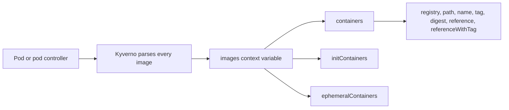

# Part 1: The images Variable

## Images, already taken apart

An image reference such as `ghcr.io/example/team/api:1.4` is one string, but a policy rarely cares about the whole string. It cares about a piece: the registry, the tag. Writing a regular expression for each piece is fragile, because references have optional parts. `nginx` has no registry and no tag. `nginx:1.27` has no registry. `ghcr.io/example/api@sha256:...` has a digest instead of a tag.

Kyverno does the parsing once. When a request contains a Pod, or a pod controller such as a Deployment, Kyverno reads every container image and builds a variable named `images` in the rule context. You can use it in conditions, messages and preconditions of any rule that matches those resources.

## The structure

`images` is a map with up to three groups. Inside a group, each entry is keyed by the **container name**:

```json
{
  "containers": {
    "api": {
      "registry": "ghcr.io",
      "path": "example/team/api",
      "name": "api",
      "tag": "1.4",
      "reference": "ghcr.io/example/team/api:1.4",
      "referenceWithTag": "ghcr.io/example/team/api:1.4"
    }
  },
  "initContainers": {
    "migrate": {
      "registry": "docker.io",
      "path": "library/busybox",
      "name": "busybox",
      "tag": "latest",
      "reference": "busybox",
      "referenceWithTag": "docker.io/library/busybox:latest"
    }
  }
}
```

The three groups are `containers`, `initContainers` and `ephemeralContainers`. A group appears only when the resource has containers of that kind.



Take care with two words. The **key** of an entry is the container name, for example `api`. The `name` **field** is the last path segment of the image, for example `api` or `busybox`. They are often different.

## The fields of an entry

| Field | Meaning |
| :--- | :--- |
| `registry` | Registry host. Kyverno sets an empty registry to `docker.io` by default. |
| `path` | Repository path below the registry. |
| `name` | Last segment of the path. |
| `tag` | The tag. Kyverno sets an empty tag to `latest` when there is no digest. |
| `digest` | The digest, when the reference is pinned. |
| `reference` | The reference as it was written in the resource. |
| `referenceWithTag` | The reference with the tag added. |

`tag` and `digest` are mutually exclusive, because a reference carries only one of them. A digest-pinned image therefore has an empty `tag`. A rule that tests for `latest` does not trip on a digest-pinned image.

> [!NOTE]
> The defaults for an empty registry and an empty tag come from Kyverno's configuration. The defaults above are the standard ones. If a cluster changes them, the values in `images` change with them.

## Querying with JMESPath

You reach into `images` with the same `{{ }}` syntax used everywhere in Kyverno. Name one container to get one value, or use a wildcard to get a list across all containers of a group:

| Query | Result |
| :--- | :--- |
| `{{ images.containers.api.registry }}` | the registry of the container named `api` |
| `{{ images.initContainers.migrate.tag }}` | the tag of the init container named `migrate` |
| `{{ images.containers.*.registry }}` | a list with one registry per container |
| `{{ images.containers.*.tag }}` | a list with one tag per container |
| `{{ images.containers."my-app".name }}` | quotes are needed for a container name with a hyphen |

A wildcard query returns a **list**. That is what makes whole-Pod checks short. Combine a list with a set operator and one condition covers every container at once.

## A registry allow list

Deny the Pod when any container uses a registry outside the list:

```yaml
apiVersion: kyverno.io/v1
kind: ClusterPolicy
metadata:
  name: allowed-registries
spec:
  validationFailureAction: Enforce
  background: false
  rules:
    - name: registry-allow-list
      match:
        any:
          - resources:
              kinds: ["Pod"]
      validate:
        message: "Images must come from docker.io or ghcr.io."
        deny:
          conditions:
            any:
              - key: "{{ images.containers.*.registry }}"
                operator: AnyNotIn
                value: ["docker.io", "ghcr.io"]
```

`AnyNotIn` is true when at least one element of the key list is missing from the value list. A Pod with one `quay.io` container among three allowed ones is therefore denied.

## Blocking the latest tag

The same shape checks the tag:

```yaml
        deny:
          conditions:
            any:
              - key: "{{ images.containers.*.tag }}"
                operator: AnyIn
                value: ["latest"]
```

Because Kyverno fills an empty tag with `latest`, this condition also catches a bare `nginx`, where nobody wrote the word `latest`.

## One rule, Pods and Deployments

You wrote `kinds: ["Pod"]`, and you did not write a rule for Deployments. Kyverno auto-generates rules for pod controllers from a rule that matches Pods, and it builds `images` from the pod template of the controller. The same `deny` condition therefore applies to a Deployment, a StatefulSet and a DaemonSet. An offending Deployment is blocked at the Deployment itself, before any Pod exists.

<!-- astrona:playground:renew -->

> [!TIP]
> **Try it — read the variable**
>
> Apply the registry rule above, but change the `message` to print the list:
> `message: "registries seen: {{ images.containers.*.registry }}"`. Then create a Pod from a registry that is not allowed:
>
> ```sh
> kubectl apply -f allowed-registries.yaml
> kubectl run probe --image=quay.io/example/app:1.0 --restart=Never
> ```
>
> The request is denied and the message lists `quay.io`. Run the same command with `--image=nginx:1.27` and it is admitted, because Kyverno filled in `docker.io`. Then create a Deployment with `kubectl create deployment web --image=quay.io/example/app:1.0` and confirm the Deployment itself is denied.

> [!WARNING]
> **Common pitfalls**
>
> - **Confusing the key with the `name` field.** The key is the container name from the Pod spec. The `name` field comes from the image path.
> - **Forgetting the defaults.** An image with no registry is `docker.io`, so an allow list without `docker.io` rejects `nginx:1.27`. An image with no tag is `latest`.
> - **Using `AnyIn` where you meant `AnyNotIn`.** An allow list needs `AnyNotIn` to deny, and a block list needs `AnyIn`.
> - **Only checking `containers`.** Init and ephemeral containers live in their own groups. A rule that reads only `containers` leaves those images unchecked.
> - **Querying a group that does not exist.** A Pod without init containers has no `initContainers` group, so test such a rule against a Pod without them.
